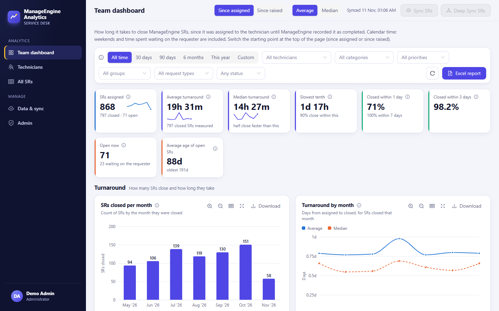
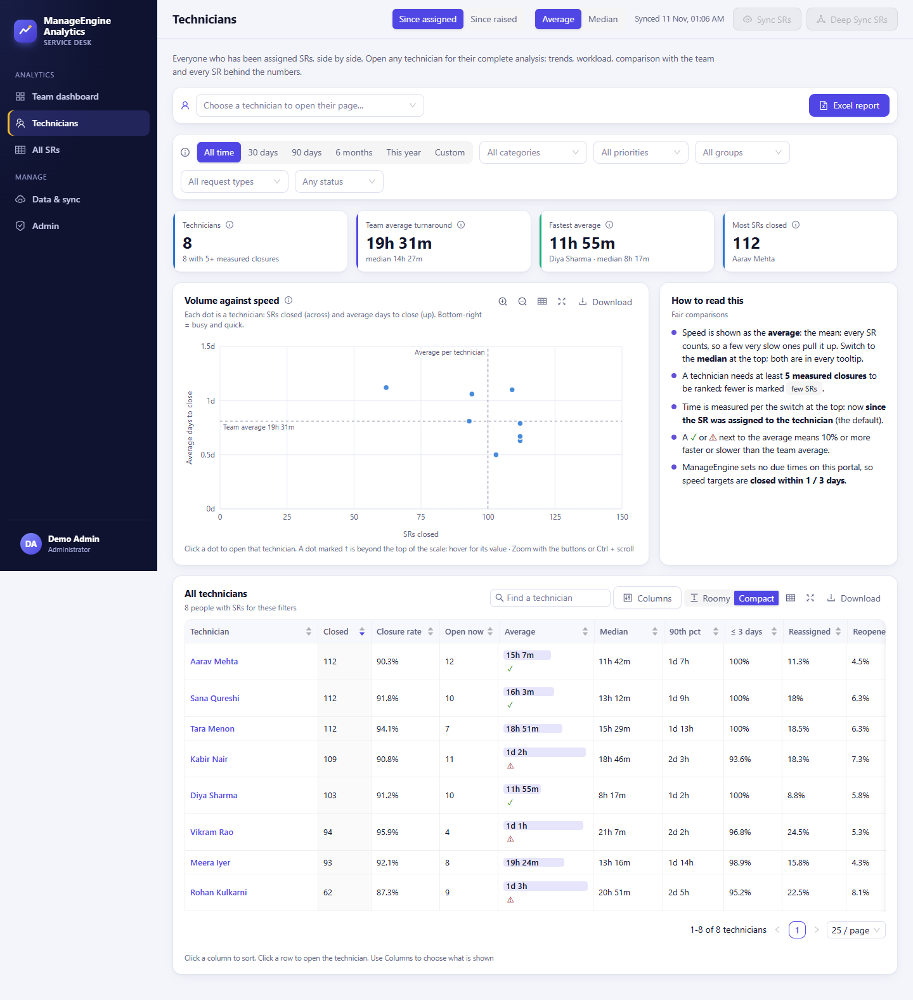
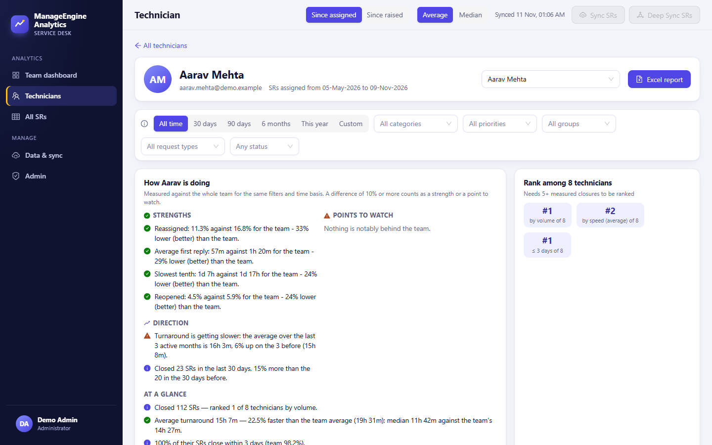
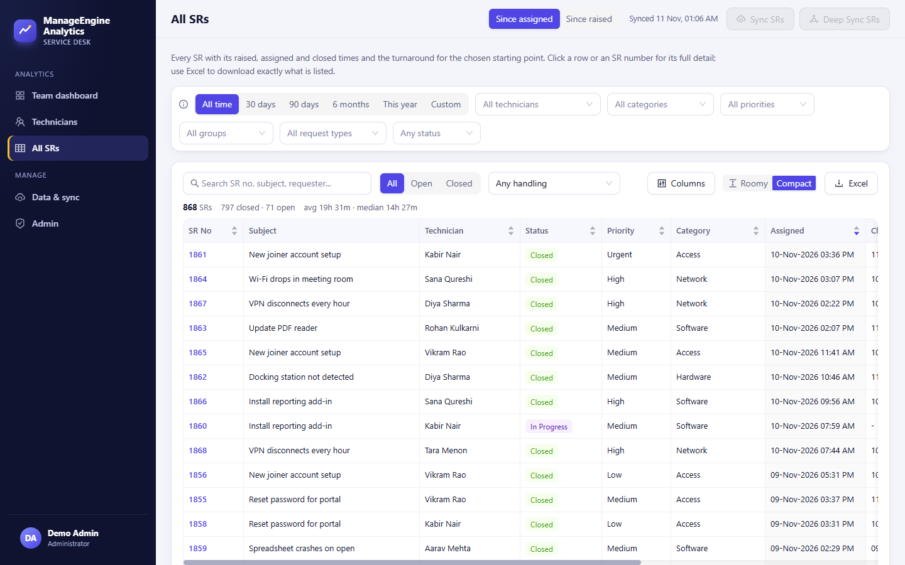
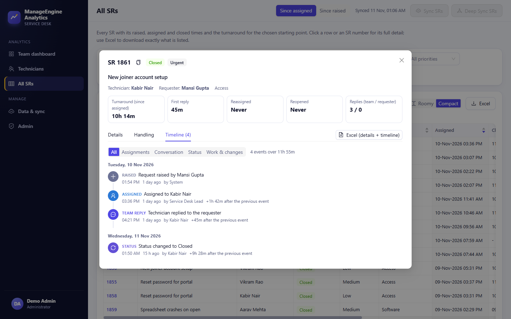
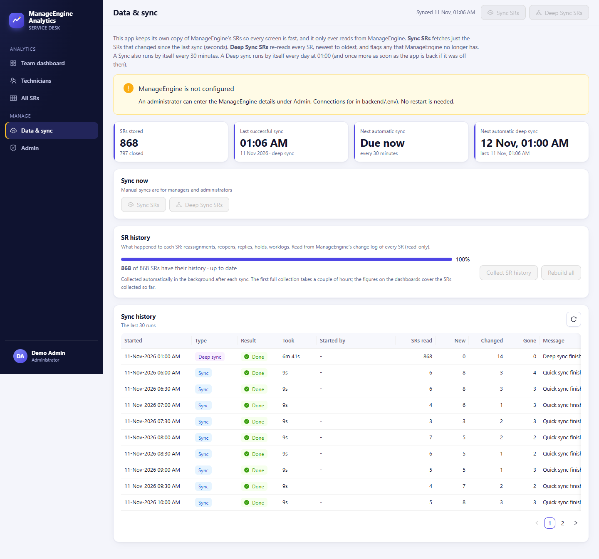

# ManageEngine Analytics

[](https://nodejs.org/)
[](https://expressjs.com/)
[](https://react.dev/)
[](https://www.mysql.com/)

An analytics application for **ManageEngine ServiceDesk Plus Cloud**. It answers the questions the built-in reports do not: how long each technician really takes to close a service request (SR), how SRs are handled along the way (reassignments, reopens, first replies, time on hold), and how every technician compares with the team, with a full timeline behind every number.

It keeps its own MySQL copy of the SR data so every screen is fast, and it **only ever reads** from ManageEngine (OAuth scope `SDPOnDemand.requests.READ`).

> Every screenshot below was taken from a throwaway database filled with **invented** technicians, requesters and SRs by [`backend/scripts/seed-demo.js`](backend/scripts/seed-demo.js). No real service-desk data is in this repository.



## What it does

| Area | What you get |
|---|---|
| **Team dashboard** | KPIs, SRs closed per month, turnaround by month, closed-within-1/3/7-day rates, open backlog and its age, with filters for period, technician, category, priority, group, request type and status. |
| **Technicians** | Every technician side by side (closures, closure rate, average, median, 90th percentile, reassignment and reopen rates), a volume-against-speed chart, and a full profile page per person. |
| **All SRs** | Every SR with raised, assigned and completed times and turnaround. Click one for details, handling figures and a complete event timeline. |
| **Two ways to measure** | *Since assigned* (default) or *since raised*, and *average* or *median*, switchable at the top of every analytics page. |
| **Downloads** | Every chart downloads as PNG, Excel or CSV of exactly the numbers drawn; dashboards, technician and SR lists have full server-built Excel reports. |
| **Sync** | Quick sync (only changed SRs), deep sync (re-reads everything and flags SRs ManageEngine no longer has), and an automatic schedule with catch-up if the PC was off. |
| **Administration** | Users and roles, activity log, every threshold and schedule as an editable setting, encrypted connection secrets, scheduled MySQL backups with optional email. |

## Screens

| | |
|---|---|
|  |  |
| **Technicians**: compare everyone, spot the busy-and-quick and the slow-and-stretched. | **Technician profile**: trends, workload and every SR behind the numbers. |
|  |  |
| **All SRs**: sortable, searchable, exportable. | **SR timeline**: who it was assigned to, replies, status changes and how long each step took. |
|  |  |
| **Data and sync**: manual and automatic syncs, SR-history progress and run history. | **Sign in**: lockouts, password reset by email, forced change of temporary passwords. |

## How it works

```
ManageEngine SDP Cloud (read-only API, OAuth)
        |
        v
services/sync.js      ->  requests                 one row per SR (quick, deep and automatic sync)
services/history.js   ->  request_history/_events  reassignments, first reply, reopens, holds, timeline
        |
        v
services/analytics.js     in-memory snapshot, shaped per measuring basis, cached and
        |                 invalidated when the data changes; every figure has a drill-down
        v                 that returns exactly the SRs behind it
routes/*.js  ->  JSON API + Excel reports (exceljs, streamed)  ->  React app served by the same Express process
```

Design choices worth knowing about:

- **Read-only toward ManageEngine.** Nothing is ever written back; the app stores its own copy.
- **Safe sync.** Locks are MySQL named locks, so quick sync, deep sync, history collection and backups never overlap, even across two running copies. A deep sync refuses to flag SRs as gone if the read looks incomplete.
- **Fair comparisons.** Turnaround is calendar time, with average and median always shown together, and a technician needs a minimum number of measured closures to be ranked.
- **Everything configurable on screen.** Targets, buckets, limits, schedules, names and texts live under Admin, each with help text, its default and a reset button; changes apply without a restart.
- **Security by default.** Passwords are salted scrypt hashes; the session cookie is HttpOnly and only its hash is stored; every write needs a custom request header; roles are enforced on the server for every route; sign-in lockouts, per-address rate limits and strict security headers are on. See [docs/ARCHITECTURE.md](docs/ARCHITECTURE.md).

## Quick start

You need **Node.js 20 or newer** and a running **MySQL** server.

```bash
cp backend/.env.example backend/.env      # then set the database and ManageEngine details
# Windows: double-click startup.bat (checks everything, installs, builds, starts)
cd frontend && npm install && npm run build
cd ../backend && npm install && npm start
```

Open <http://localhost:7780>. On the very first start the administrator is created from `ADMIN_EMAIL` and `ADMIN_PASSWORD` in `backend/.env` (if the password is blank, a random temporary one is printed once and must be changed at first sign-in).

### Try it without ManageEngine

```bash
# backend/.env: DB_NAME=manageengine_analytics_demo   NO_BACKGROUND=1
cd backend && npm start        # first start creates the tables and the administrator
npm run seed:demo              # in a second terminal: fills the demo database with fictional SRs
```

The seed script refuses to run unless the database name ends in `_demo`, so it can never overwrite real data.

## Roles

| Role | Can do |
|---|---|
| Administrator | Everything, including users, activity log, settings, connections and backups |
| Manager | All analytics, and run syncs |
| Viewer | All analytics, read only |

## Documentation

| Document | What is in it |
|---|---|
| [docs/USER_GUIDE.md](docs/USER_GUIDE.md) | Day-to-day use: signing in, how turnaround is measured, syncing, SR history, downloads, backups, password reset, every `.env` setting |
| [docs/ARCHITECTURE.md](docs/ARCHITECTURE.md) | Data flow, sync modes, history parsing, analytics engine, security model, frontend |
| [docs/OPERATIONS.md](docs/OPERATIONS.md) | Running, syncing, backups and restore |
| [docs/CONFIGURATION.md](docs/CONFIGURATION.md) | Every setting and what it does |
| [docs/CHANGELOG.md](docs/CHANGELOG.md) | What changed and why |
| [SECURITY.md](SECURITY.md) | Reporting a vulnerability and deployment safeguards |
| [CONTRIBUTING.md](CONTRIBUTING.md) | Working on the code |

## Repository map

```
backend/    Express API, sync and history services, analytics engine, reports, backups
  scripts/  sync.js (command-line sync), seed-demo.js (fictional demo data)
frontend/   React app (Vite, Ant Design, Recharts)
docs/       Guides, architecture, operations, configuration, screenshots
startup.bat One-click start on Windows
```

## Data boundary

This repository contains source code and documentation only. Credentials, the encryption key, database backups and real service-desk data are never committed (`.env`, `backend/.secret` and `backend/db-backup/` are ignored).
